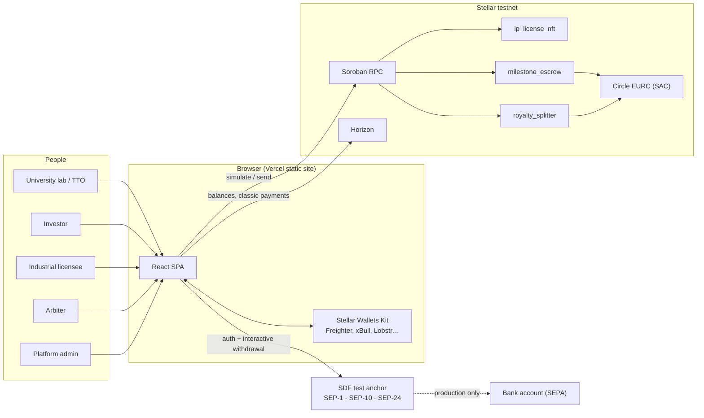
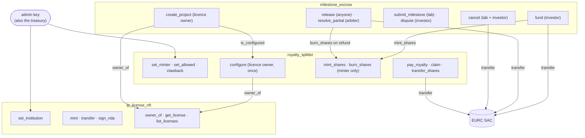
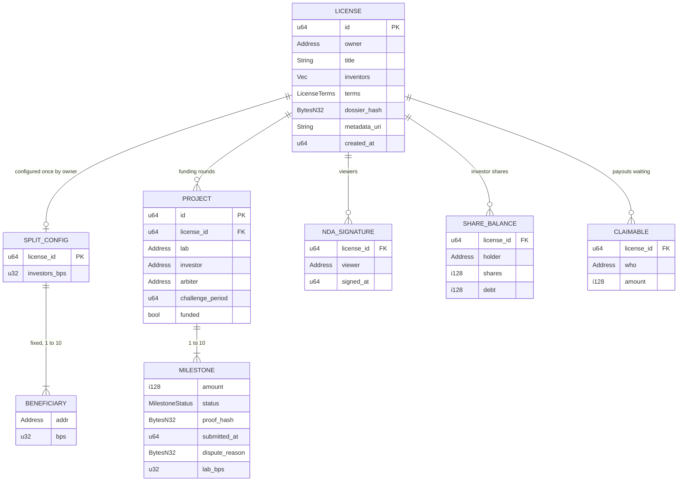
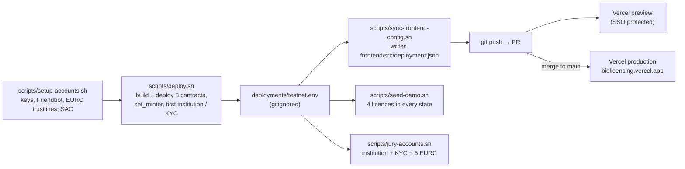
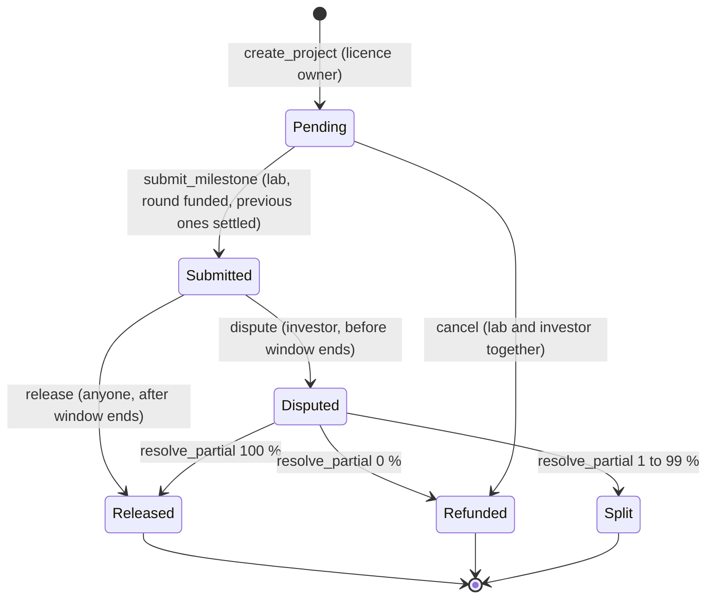
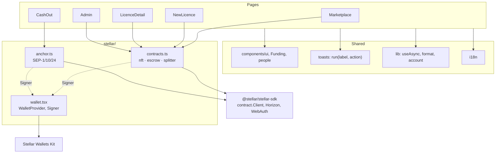
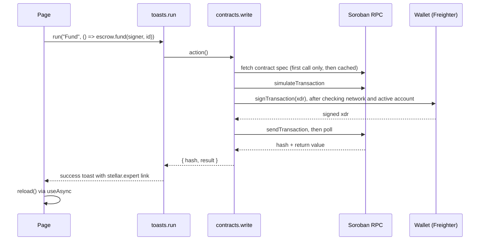
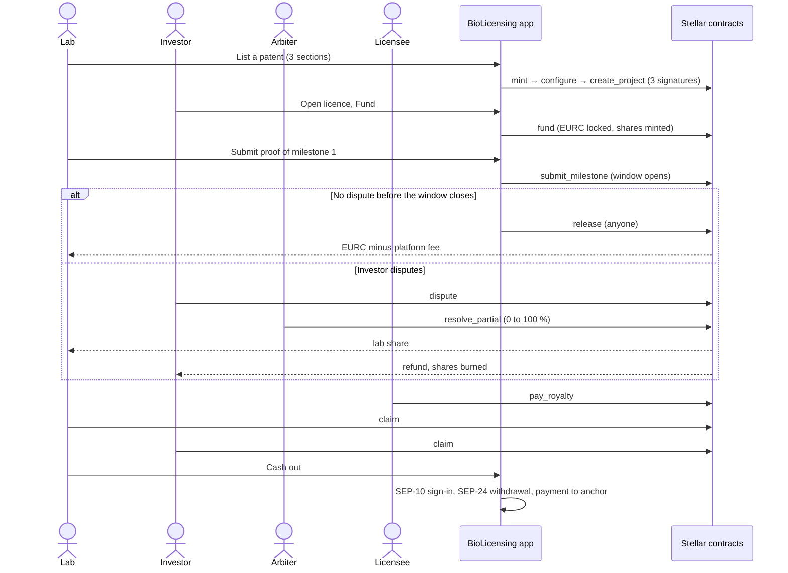

# BioLicensing: codebase overview

A review of the whole repository from three angles (software architect,
software developer, product manager), with diagrams, a prioritised list of
findings and the questions we should answer before the next iteration.

> **Snapshot.** Written against `main` at `a0a90e4` (26 October 2026), the
> commit currently served at <https://biolicensing.vercel.app>. File and line
> references point at that commit. The [README](README.md) remains the entry
> point for running the project; this document is for deciding what to build
> next.
>
> **Checked at that commit:** `cargo test` passes (30/30), `npm run build`
> succeeds and `npm run test:i18n` passes (3/3).

## Contents

1. [At a glance](#1-at-a-glance)
2. [Architecture (software architect)](#2-architecture-software-architect)
3. [Code walkthrough (software developer)](#3-code-walkthrough-software-developer)
4. [Product review (product manager)](#4-product-review-product-manager)
5. [Findings, prioritised](#5-findings-prioritised)
6. [Questions to settle](#6-questions-to-settle)
7. [Suggested next pull requests](#7-suggested-next-pull-requests)
8. [Glossary](#8-glossary)

---

## 1. At a glance

| | |
| --- | --- |
| **What it is** | A testnet MVP that turns a university patent into a programmable licence on Stellar: funded in EURC, released by milestones, royalties split automatically |
| **On-chain** | 3 Soroban contracts in Rust (`soroban-sdk` 28): `ip_license_nft`, `milestone_escrow`, `royalty_splitter` (~1,330 lines, 30 unit tests) |
| **Off-chain** | A single-page React 19 + Vite 8 + Tailwind 4 app (~4,500 lines of TS/TSX), no backend, no database |
| **External services** | Soroban RPC and Horizon (testnet), Circle EURC through its Stellar Asset Contract, Stellar Wallets Kit, SDF test anchor (SEP-1/10/24) |
| **Hosting** | Vercel, production deployed from `main`, a preview per pull request |
| **Languages** | UI in English, French and Portuguese; code, comments, scripts and docs in English |
| **Maturity** | Demo-ready on testnet. Not audited, not upgradable, single admin key |

What works well, in one sentence each:

- **Clean separation of concerns on-chain.** One contract per responsibility
  (identity of the licence, money in escrow, money from royalties), wired
  together through narrow cross-contract interfaces.
- **Sound royalty maths.** A per-share accumulator with pull payments keeps
  `pay_royalty` at constant cost whatever the number of holders.
- **Honest scope.** README, roadmap and prior-work disclosure match what the
  code actually does, with a few exceptions listed in [section 5](#5-findings-prioritised).
- **Thoughtful UX for non-crypto users.** Plain-language actions, translated
  wallet errors, an account checker that needs no wallet, three languages with
  a parity test.

---

## 2. Architecture (software architect)

### 2.1 System context



There is **no server of our own**. Every read is a Soroban simulation sent from
the browser, every write is signed in the user's wallet, and the only state
outside the chain is what the browser keeps in `localStorage` /
`sessionStorage` (theme, language, wallet choice, demo role).

### 2.2 Contract topology and trust



`milestone_escrow` is the only contract that calls the other two. It is the
registered **minter** of the splitter, so funding a round creates revenue
shares 1:1 with the EURC locked (7 decimals), and refunds burn them.

### 2.3 Key design decisions

| Decision | Where | Consequence |
| --- | --- | --- |
| One instance per contract, data keyed by `license_id` / `project_id` | all contracts | One deployment, simple front-end; every licence shares the same admin, fee and token |
| No backend: the front-end reads state through RPC simulations | `frontend/src/stellar/contracts.ts` | Nothing to operate, but reads grow linearly with the number of licences (see [2.6](#26-scalability-and-operational-limits)) |
| Revenue shares live inside `royalty_splitter`, not as a classic Stellar asset | `royalty_splitter` | The contract sees every transfer, which the accumulator needs; KYC allowlist and clawback are enforced in code |
| Optimistic milestone validation with a named arbiter | `milestone_escrow` | Cheap in the happy path; trust concentrates on the arbiter in disputes |
| Arbiter can **split** a milestone (`resolve_partial`) | `milestone_escrow` | Models a good-faith research failure instead of a binary win/lose |
| Dossier kept off-chain, only its SHA-256 on-chain | `ip_license_nft`, `lib/format.ts` | Proves the dossier without publishing it |
| Contract spec fetched at runtime instead of generated bindings | `contracts.ts` lines 71–96 | No codegen step, but no compile-time check that TS types match the Rust structs |
| Instance TTL not extended on writes | `ip_license_nft` lib.rs line 153 | Saved ~1,059 XLM of rent per licence on testnet; instance must be extended by an operator |

### 2.4 On-chain data model



Storage classes: counters, admin, token, fee and wiring sit in **instance**
storage; everything per licence, per project or per holder sits in
**persistent** storage with a TTL extended to 30 days on each write
(`TTL_EXTEND_TO = 30 * DAY_IN_LEDGERS`). Reads never extend a TTL.

### 2.5 Delivery pipeline



Contract deployment is manual and outside CI; the front-end only learns about a
new deployment when `deployment.json` is committed. There is no GitHub Actions
workflow: `cargo test`, `tsc` and `npm run test:i18n` run only when someone
runs them locally (Vercel runs `npm run build`, which includes `tsc`).

### 2.6 Scalability and operational limits

| Limit | Today | When it bites |
| --- | --- | --- |
| Marketplace reads | `loadListings` (Marketplace.tsx line 14) makes 1 + 2 simulations per licence | Around a few dozen licences: slow first paint, RPC rate limits |
| Page size | `list_licenses` caps at 50 (`MAX_PAGE`) and the UI asks for one page only | Licence #51 never appears in the marketplace |
| Milestones per round | 10 (`MAX_MILESTONES`) | Fine for research programmes |
| Fixed beneficiaries | 10 (`MAX_FIXED_BENEFICIARIES`) | Large inventor teams |
| Archival | Persistent entries live 30 days after their last write; the instance is extended by hand | On mainnet, a quiet licence or the whole contract can be archived and must be restored before use |
| Upgrades | No `upgrade` entry point | Any contract fix means a new contract ID and migrating every licence |
| Bundle | Main chunk 914 kB minified (276 kB gzip); only the Three.js helix is lazy-loaded | Slow first load on mobile networks |

---

## 3. Code walkthrough (software developer)

### 3.1 Repository map

```text
contracts/                       Cargo workspace (soroban-sdk 28, release profile opt-level "z")
  ip_license_nft/src/lib.rs      247  licences, institutions, NDA log
  milestone_escrow/src/lib.rs    546  rounds, milestones, disputes, fees
  royalty_splitter/src/lib.rs    538  shares, KYC allowlist, royalties, claims
  */src/test.rs                  788  30 tests in total (5 + 15 + 10)
frontend/
  src/main.tsx                        router: /, /new, /licence/:id, /admin, /cash-out
  src/config.ts, deployment.json      network constants and public contract IDs
  src/stellar/contracts.ts       285  typed wrappers over every contract call + error mapping
  src/stellar/wallet.tsx         191  Wallets Kit signer, demo signer, session restore
  src/stellar/anchor.ts          230  SEP-1, SEP-10, SEP-24 and classic payments
  src/pages/*.tsx              1,824  the five screens
  src/components/*.tsx         1,650  UI kit, toasts, 3D/SVG visuals, layout
  src/i18n/{en,fr,pt}.json   450 each  translations, parity-tested by tests/i18n.test.mjs
scripts/                              testnet accounts, deploy, seed, jury accounts (bash + stellar CLI)
docs/PLAN.md                          original development plan
```

### 3.2 Contracts

**`ip_license_nft`.** A registry rather than a token standard: `mint` requires
the owner to be a verified institution and stores a `License` with terms,
inventors, the dossier hash and a free-form `metadata_uri`. `transfer` is only
allowed towards another institution. `sign_nda` records a timestamp per
(licence, viewer) once.

**`milestone_escrow`.** Each project belongs to a licence and freezes `lab`
(the licence owner at creation), `investor`, `arbiter` and `challenge_period`.
Milestones move through this state machine:



Money flows: `fund` pulls the whole round from the investor and mints the same
number of shares; a release pays `amount − fee` to the lab and the fee to the
treasury; a refund returns EURC to the investor and burns
`min(investor shares, amount)` (the investor may have sold shares meanwhile).

**`royalty_splitter`.** For each licence the owner configures, once, fixed
beneficiaries (university first, then inventors) and an investors' percentage
that must add up to 10,000 bps. For a royalty of amount `A`:

```text
fee        = A × fee_bps / 10 000                 → treasury
net        = A − fee
fixed_i    = net × bps_i / 10 000                 → claimable[i]
investors  = net × investors_bps / 10 000
acc       += investors × 10^12 / total_shares     (if shares exist, else → first beneficiary)
pending(h) = shares(h) × acc / 10^12 − debt(h)    settled on every mint, burn, transfer and claim
rounding   → first fixed beneficiary
```

Every state change emits a typed `#[contractevent]`, which makes an indexer
straightforward to add later.

### 3.3 Front-end



A write, end to end:



Notable implementation choices:

- **Single seam for chain access.** All contract calls go through `read` /
  `write` in `contracts.ts`; errors are mapped once from
  `Error(Contract, #n)` to translated messages per contract.
- **Two signer kinds.** `wallet` (Stellar Wallets Kit, checks network and
  active account before every signature) and `demo` (testnet secret keys
  injected at build time from `frontend/.env.local`, never in the public
  build).
- **State management is local.** `useAsync` + a `version` counter, no global
  store or cache; a confirmed transaction fires `biolicensing:tx-confirmed` so
  the header balance refreshes.
- **Accessibility and motion.** Animated visuals respect
  `prefers-reduced-motion`; the file picker stays keyboard-reachable.

### 3.4 Tests and quality gates

| Area | Coverage | Gap |
| --- | --- | --- |
| Contracts | 30 tests: demo scenario end to end, ordering, double release, dispute window, splits, refunds after a share sale, pro-rata royalties, transfers, clawback, fee, rounding | All tests use `mock_all_auths()`; only `only_minter_can_mint` asserts who signed. Arbiter-only, investor-only, lab-only and admin-only checks are untested |
| Front-end | `tsc --noEmit` in the build, i18n parity and interpolation tests | No unit or end-to-end tests for flows, no lint step |
| CI | None | Nothing blocks a PR that breaks `cargo test` or the i18n test |

### 3.5 Maintainability notes

Strengths: small files with one job each, consistent naming, comments that
explain *why* (e.g. the TTL fix, the refund burn rule), pinned dependency
versions, a `CONTRIBUTING.md` the team follows.

Debts worth paying down:

1. TypeScript types in `contracts.ts` mirror the Rust structs by hand;
   `stellar contract bindings typescript` (planned in `docs/PLAN.md`) would
   catch drift at build time.
2. The `normalizeProject` workaround for unit enums shows the runtime spec
   decoder's quirks leaking into app code.
3. `pages/LicenceDetail.tsx` (592 lines) and `pages/NewLicence.tsx` (473
   lines) mix data loading, validation and rendering; extracting hooks would
   make them testable.

---

## 4. Product review (product manager)

### 4.1 Who it serves

| Persona | Job to be done | What the product gives today |
| --- | --- | --- |
| University lab / tech transfer office | Fund proof of concept without selling the patent | Listing form with no crypto jargon, milestone payouts, royalty share, anchor cash-out |
| Investor | Back academic research with control over how money is spent | Milestone escrow, dispute right, pro-rata royalties |
| Industrial licensee | Pay royalties once and be done | One EURC payment split on-chain |
| Inventors | Get their contractual share without chasing it | Fixed percentage locked at listing, claim at any time |
| Arbiter | Settle disputes fairly | Approve, refund or split with a slider |
| Platform admin | Keep the platform compliant | Institution registry, KYC allowlist, account checker |

### 4.2 End-to-end journey



### 4.3 Feature coverage: contract vs interface

| Capability | Contract | UI |
| --- | --- | --- |
| List a patent, configure split, open a round | ✅ | ✅ (three transactions in a row) |
| Fund, submit proof, dispute, release | ✅ | ✅ |
| Arbiter approve / refund / split | ✅ | ✅ |
| Pay royalty, claim | ✅ | ✅ |
| Sign NDA, check dossier fingerprint | ✅ | ✅ |
| Institution registry, KYC allowlist | ✅ | ✅ (admin page) |
| Cancel a round by mutual agreement | ✅ | ❌ needs two signatures on one transaction |
| Transfer a licence to another institution | ✅ | ❌ |
| Trade revenue shares between KYC'd investors | ✅ | ❌ |
| Clawback | ✅ | ❌ |
| Resume a listing whose 2nd or 3rd transaction failed | ✅ (`configure`, `create_project` callable later) | ❌ |
| Open a second round on an existing licence | ✅ | ❌ |
| Portfolio view ("my licences", "my shares", "my claims") | n/a | ❌ claims are per licence page |
| Bank cash-out of EURC | n/a | ⚠️ flow complete, but the test anchor does not list EURC |

### 4.4 Alignment with business goals

- **Revenue model is in code.** The 1 % fee is taken by the contracts on
  milestone releases and royalties, so it cannot be bypassed through the UI.
  Funding itself carries no fee, and refunds are fee-free.
- **"Marketplace" is really a bilateral deal registry today.** The investor is
  named by the lab when listing, and only that address can fund. Discovery
  happens off-platform. This is the biggest gap between the pitch and the
  product, and the roadmap's "syndicated rounds" item addresses it.
- **The licensee is not a first-class entity.** `exclusive`, `territory` and
  `field` are descriptive strings; no licensee address, agreement hash or
  royalty schedule is recorded, and anyone can call `pay_royalty`. That keeps
  the MVP simple, but limits reporting and the "usage-based royalties" roadmap
  item.
- **Compliance story is credible for a demo** (institution allowlist, KYC
  allowlist, clawback, EURC under MiCA) and rests on one admin key for now.

### 4.5 UX observations

- The listing form is pre-filled with a sample title, the demo inventor, the
  demo fund, the demo arbiter and a 1-minute window
  (`NewLicence.tsx` lines 95–110). Great on stage; on the public site a real
  lab could name the demo fund as its investor without noticing.
- Milestone proofs and dispute reasons are typed as free text, hashed in the
  browser and **the text is thrown away** (`LicenceDetail.tsx` lines 263 and
  276). The investor and arbiter see only a hash, so they need another channel
  to read the proof they are asked to judge.
- The data room copy says the dossier "stays encrypted off-chain" and that the
  NDA is recorded "before access is granted", but `metadata_uri` is public
  in `get_license`; the NDA gate only hides the link in the UI.
- Countdown and the "Release" button use the browser clock, not the ledger
  time, so a release clicked right at the deadline can fail with "challenge
  window still open".
- A licence whose listing stopped after the first transaction shows in the
  marketplace with "No funding round yet", and its licence page crashes (the
  royalties panel reads a split that does not exist), with no way for its
  owner to finish the setup.

---

## 5. Findings, prioritised

Severity reflects the impact **before mainnet**; on testnet with test assets
none of these is urgent for the demo.

| # | Severity | Area | Finding | Suggested direction |
| --- | --- | --- | --- | --- |
| 1 | High | Escrow | **Funds can stay locked forever.** No deadline for submitting a milestone, `cancel` needs both lab and investor (lib.rs line 383), and a disputed milestone waits for the arbiter with no timeout | Add a per-milestone deadline after which the investor can reclaim Pending funds, and an arbiter timeout |
| 2 | High | Escrow | **The lab picks the arbiter and the window.** Only `arbiter == investor` is rejected (line 212); `arbiter == lab` is allowed, and `challenge_period = 0` makes disputes impossible. The investor's only protection is reading these before funding | Reject `arbiter == lab`, enforce a minimum window, show both prominently on the Fund button |
| 3 | High | Platform | **Single admin key** is also the treasury and can `set_minter` to itself, then mint shares to any allowlisted address, besides clawback and both registries | Role split and multisig (already on the roadmap); make `set_minter` one-time or timelocked |
| 4 | Medium | Contracts | **No upgrade path and manual TTL management.** Any fix means new contract IDs; quiet entries are archived after 30 days on mainnet | Admin-gated `upgrade` behind a timelock; a scheduled job that extends TTLs |
| 5 | Medium | Tests | Role checks are untested (all tests mock every auth) | Add `try_*` tests with `mock_auths` for each role-gated function |
| 6 | Medium | Process | No CI | GitHub Actions: `cargo test`, `npm run build`, `npm run test:i18n` on every PR |
| 7 | Medium | Product | Data room promise does not match the code (finding in [4.5](#45-ux-observations)) | Reword the copy now; encrypted data room later |
| 8 | Medium | Product | Proof text is not stored anywhere reachable | Upload the proof file (or text) to off-chain storage and keep its hash on-chain, as for the dossier |
| 9 | Medium | UX | Non-atomic 3-step listing with no resume | Detect the missing step on the licence page and offer "Finish setup" to the owner |
| 10 | Medium | Design | Licence transfer leaves the escrow `lab` and the royalty beneficiaries unchanged | Decide whether payouts follow the licence owner; document either way |
| 11 | Low | Economics | After a refund, shares the investor already sold stay with the buyer although the capital went back (by design, see comment at line 481) | Confirm with the team that this is the intended rule |
| 12 | Low | Scalability | Marketplace does 1 + 2N RPC simulations and stops at 50 licences | Paginate, then add an event indexer or cached read model |
| 13 | Low | UX | Demo defaults in the public listing form | Keep them behind demo mode only |
| 14 | Low | UX | Browser clock vs ledger time around the deadline | Add a small margin or read the latest ledger time |
| 15 | Low | Robustness | `/licence/abc` throws in `BigInt(id)` during render (line 484) and the router shows its default error page | Validate the param; add an `errorElement` |
| 16 | Low | Robustness | Cash-out state lives in memory (a refresh mid-withdrawal loses the transaction id) and the SEP-10 token is cached without expiry | Persist the withdrawal id per account; drop the token on 401 |
| 17 | Low | Security hygiene | The README publishes testnet secret keys for the jury; `VITE_DEMO_SECRETS` would be baked into the public bundle if ever set on Vercel | Rotate the jury accounts after judging; fail the build if that variable is set in production |
| 18 | Low | Performance | 914 kB main chunk, routes not code-split; the WebGL helix runs behind every page except home | Lazy-load routes; consider a static helix on inner pages |
| 19 | Info | Maths | Accumulator rounding leaves a few stroops of dust in the splitter; amounts are shown truncated to 2 decimals | Document; no action needed |

---

## 6. Questions to settle

**Architecture**

1. Do we keep "no backend" for a pilot, or add a thin indexer (events → read
   model) for the marketplace, portfolios and notifications?
2. Which admin model do we target first: Stellar multisig on one key, or
   on-chain roles in the contracts?
3. Should payouts follow the current licence owner (`owner_of` at release
   time) instead of the address frozen when the round was created?
4. What is our upgrade policy: upgradable contracts with a timelock, or
   immutable contracts plus a migration tool?

**Development**

5. Generate TypeScript bindings from the contracts, or keep the runtime spec
   and add a test that compares the TS types with the deployed spec?
6. What is the minimum CI we agree on, and who owns contract deployments
   (scripts are manual today)?
7. Do we standardise code comments on English?

**Product**

8. Is the target an open marketplace (any KYC'd investor funds a listed
   round) or a tool for deals negotiated elsewhere? The data model differs.
9. Where do milestone proofs live, and who can read them: investor and
   arbiter only, or anyone who signed the NDA?
10. What happens when research stalls: who can trigger a refund, after how
    long, and does the lab keep anything?
11. Who are the arbiters in a pilot (TTO boards, expert panels, a mediation
    service) and how are they paid?
12. Should licensees be identified on-chain, with an agreement hash and a
    royalty schedule, to support reporting and usage-based royalties?
13. Which EURC anchor do we target for the production cash-out, and does it
    also support SEP-24 deposits for investors?

---

## 7. Suggested next pull requests

Small, independent changes in the order we would take them. Following
`CONTRIBUTING.md`, anything under `contracts/` or `frontend/src/stellar/` needs
Antoine's approval first, and visual changes need before/after screenshots.

| Order | Branch | Scope | Touches protected code |
| --- | --- | --- | --- |
| 1 | `chore/ci` | GitHub Actions running `cargo test`, `npm run build`, `npm run test:i18n` | No |
| 2 | `fix/data-room-copy` | Make the data room text match what the code does today | No |
| 3 | `fix/listing-demo-defaults` | Empty form and a 1-day default window outside demo mode | No |
| 4 | `feat/finish-listing-setup` | "Finish setup" on a licence missing its split or round | No |
| 5 | `fix/licence-route-param` | Validate `:id`, add an `errorElement` | No |
| 6 | `test/contract-auth` | Role tests for every gated function | Yes (`contracts/`) |
| 7 | `feat/escrow-deadlines` | Milestone deadline, arbiter timeout, `arbiter != lab`, minimum window | Yes (`contracts/`) |
| 8 | `feat/marketplace-pagination` | Page through `list_licenses` beyond 50 | No |

---

## 8. Glossary

| Term | Meaning here |
| --- | --- |
| **bps** | Basis points; 10,000 bps = 100 % |
| **Challenge window** | Time after a proof during which the investor can dispute (`challenge_period`, seconds) |
| **EURC** | Circle's euro stablecoin; on Soroban it is used through its Stellar Asset Contract (SAC) |
| **IP-NFT** | Here, a licence record in `ip_license_nft` with its own `owner_of` / `transfer`; it does not implement a standard token interface |
| **Pull payment** | Beneficiaries withdraw (`claim`) instead of being paid automatically |
| **SEP-1 / 10 / 24** | Stellar standards for an anchor's `stellar.toml`, web authentication, and interactive deposit/withdrawal |
| **Stroop** | Smallest unit of a Stellar asset, 10⁻⁷ |
| **TTL** | Time to live of a Soroban storage entry before it is archived |
| **TTO** | Technology transfer office of a university |
