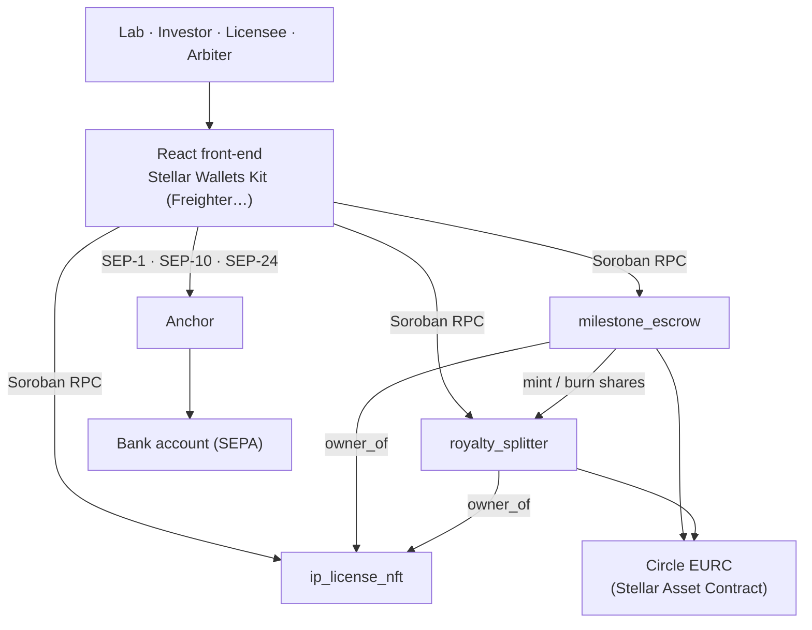

# BioLicensing

**Funding European research, one patent at a time.** BioLicensing turns a
university patent into a programmable licence on Stellar: funded in EURC,
released by milestones, with royalties shared automatically. Biotech first,
then any European research patent.

Built for **HackMeridian** (Lisbon, 25–26 October 2026) · Track: **Genesis** ·
Theme: **Stellar Composed**

| | |
| --- | --- |
| Live demo | [https://biolicensing.vercel.app](https://biolicensing.vercel.app) |
| Demo video | _[link]_ |
| Network | Stellar **testnet** (all amounts are test assets) |

---

## The problem

Between an academic discovery and the moment industry is willing to pay for it
lies the "valley of death": promising patents find neither funding nor a
licensee to reach proof of concept. Technology transfer today is slow (bilateral
negotiations, intermediaries, legal fees) and opaque for investors, who see
little of how their money is used.

## The solution

1. **A university lists a patent as a licence IP-NFT.** It stays the owner: the
   token carries the licence terms and the SHA-256 fingerprint of the
   scientific dossier, which never leaves the lab.
2. **An investor funds it in EURC**, locked in an escrow split into milestones,
   and receives revenue shares.
3. **The lab proves a milestone.** If the investor does not dispute it within
   the challenge window, anyone can release the funds; a dispute goes to an
   arbiter named upfront (optimistic validation).
4. **An industrial licensee pays royalties in EURC**, split in one transaction
   between the university, its inventors and the investors (pro rata).
5. **The lab cashes out to its bank account** through a Stellar anchor
   (SEP-24): researchers never have to handle crypto.

| Target user | What they get |
| --- | --- |
| University lab / tech transfer office | Euros to reach proof of concept without selling the patent, paid out to its bank account |
| Investor (VC, specialised fund, industrial) | Direct access to academic deal flow, milestone-based release, automatic royalties |
| Industrial licensee | One EURC payment, split on-chain |
| Inventors | A fixed share of every royalty, locked when the licence is created |

**Compliance by design:** only verified institutions can mint licences, only
KYC-approved investors can hold or trade shares, and the admin can claw back
shares on a court order (the model of Stellar's regulated assets).
**Business model:** a platform fee taken by the contracts themselves on
milestone releases and royalties (1 % on testnet).

---

## Architecture: how Stellar is used



| Building block | What we use | Role |
| --- | --- | --- |
| Smart contracts | 3 Soroban contracts in Rust (`soroban-sdk` 28) | Licences, milestone escrow, shares and royalties |
| Stablecoin | **Circle EURC** on testnet, issuer `GB3Q6QDZYTHWT7E5PVS3W7FUT5GVAFC5KSZFFLPU25GO7VTC3NM2ZTVO`, handled in Soroban through its **Stellar Asset Contract** | Funding and royalties in regulated euros (MiCA) |
| Wallets | **Stellar Wallets Kit** (Freighter, xBull, Lobstr, Albedo…) | Users sign every transaction themselves |
| Anchor | **SEP-1** (stellar.toml), **SEP-10** (web auth), **SEP-24** (interactive withdrawal) against the SDF test anchor `testanchor.stellar.org` | Cash-out from Stellar to a bank account |
| APIs | Soroban RPC `soroban-testnet.stellar.org`, Horizon `horizon-testnet.stellar.org` | Contract calls, balances, classic payments |
| Off-chain data | SHA-256 computed in the browser (Web Crypto) | Proves the dossier without publishing it |

> **Testnet note on the anchor.** The SDF test anchor lists USDC, its SRT test
> token and XLM, not EURC, and moves no real money. The demo therefore runs the
> full SEP-10 + SEP-24 flow with one of those assets. In production the same
> code points at an anchor that converts EURC into SEPA transfers: only the
> anchor domain changes.

### Deployed contracts (testnet)

| Contract | ID |
| --- | --- |
| `ip_license_nft` | [`CC4INM4NVB5YUXINIFW2UEET2JSNWAKU5TO2KZQPJH32OP2QSJPVA2VV`](https://stellar.expert/explorer/testnet/contract/CC4INM4NVB5YUXINIFW2UEET2JSNWAKU5TO2KZQPJH32OP2QSJPVA2VV) |
| `milestone_escrow` | [`CAR4YUSMUYOZYX55GETFAJWBOVRHAJFPAZU44FB5CAMRORH5CMPQI6KC`](https://stellar.expert/explorer/testnet/contract/CAR4YUSMUYOZYX55GETFAJWBOVRHAJFPAZU44FB5CAMRORH5CMPQI6KC) |
| `royalty_splitter` | [`CBQ6QI4HZ46ZZEETZRY7247E4I7MITRUVWSIGPUKPQDK3YKAOOUA6POR`](https://stellar.expert/explorer/testnet/contract/CBQ6QI4HZ46ZZEETZRY7247E4I7MITRUVWSIGPUKPQDK3YKAOOUA6POR) |
| Circle EURC (SAC) | [`CCUUDM434BMZMYWYDITHFXHDMIVTGGD6T2I5UKNX5BSLXLW7HVR4MCGZ`](https://stellar.expert/explorer/testnet/contract/CCUUDM434BMZMYWYDITHFXHDMIVTGGD6T2I5UKNX5BSLXLW7HVR4MCGZ) |

The front-end reads these IDs from `frontend/src/deployment.json`.

### On-chain evidence (testnet)

| Step | Transaction |
| --- | --- |
| Licence IP-NFT minted | [`de29ddc0…`](https://stellar.expert/explorer/testnet/tx/de29ddc069cd9731c28eef69bdaf2723bbb87d3caea2cc57889dc2e547362d57) |
| Royalty split locked | [`451218b7…`](https://stellar.expert/explorer/testnet/tx/451218b77879b6a22e587b32d139ea854936864b7071e39cff318bb9b8687da7) |
| Funding round opened | [`db323b32…`](https://stellar.expert/explorer/testnet/tx/db323b32861903dec68766b7a78166bd60a77989e16584446502abcc321da59e) |
| NDA signed on-chain | [`2ab29a25…`](https://stellar.expert/explorer/testnet/tx/2ab29a25bee986622b61c34da8c5e900d933729b743fcd838a2416e5107e6914) |
| Escrow funded in Circle EURC | [`21b2ed85…`](https://stellar.expert/explorer/testnet/tx/21b2ed85389ce8b99ef6ea056006567dc584e266fe24aa2990533afe7eb12899) |

### The contracts

| Contract | Main functions |
| --- | --- |
| `ip_license_nft` | `mint`, `get_license`, `list_licenses`, `transfer` (institutions only), `sign_nda`, `set_institution` |
| `milestone_escrow` | `create_project`, `fund`, `submit_milestone`, `dispute`, `release` (after the challenge window), `resolve` (arbiter), `cancel` |
| `royalty_splitter` | `configure`, `pay_royalty`, `claim`, `transfer_shares` (KYC only), `clawback`, `set_allowed` |

Royalties use a per-share accumulator: paying out costs the same whatever the
number of holders, and everyone withdraws when they want (pull payments).

---

## Getting started

### Prerequisites

- Node.js 22+
- For the contracts: Rust with the `wasm32v1-none` target and the
  [Stellar CLI](https://developers.stellar.org/docs/tools/cli) 28+
- A Stellar wallet such as [Freighter](https://www.freighter.app/), set to **Testnet**

### Run the front-end (uses the deployed contracts)

```bash
git clone git@github.com:Team-hackmeridian-2026/Hackmeridian2026.git
cd Hackmeridian2026/frontend
npm install
npm run dev          # http://localhost:5173
```

No configuration is needed: the public contract IDs are committed.

### Run the contract tests

```bash
cd contracts
cargo test           # 26 tests, including the full demo scenario
```

### Deploy your own instance (optional)

```bash
EURC_MODE=circle ./scripts/setup-accounts.sh   # testnet accounts, EURC trustlines, SAC
./scripts/deploy.sh                            # build, deploy and wire the 3 contracts
./scripts/sync-frontend-config.sh              # copy the new IDs to the front-end
```

### Environment variables

| Variable | Where | Default | Meaning |
| --- | --- | --- | --- |
| `NETWORK` | scripts | `testnet` | Stellar network |
| `EURC_MODE` | `setup-accounts.sh` | `mock` | `circle` = official Circle EURC (get it on [faucet.circle.com](https://faucet.circle.com)); `mock` = a test EURC issued by our own account |
| `FEE_BPS` | `deploy.sh` | `100` | Platform fee in basis points (100 = 1 %) |
| `VITE_DEMO_SECRETS` | `frontend/.env.local` | none | **Local only, never committed.** Testnet keys of the demo accounts, written by `sync-frontend-config.sh --demo` to switch roles on stage. The public build has none and only uses wallets |

Deployment state lives in `deployments/testnet.env` (gitignored, see
`deployments/testnet.env.example`). Secret keys stay in the Stellar CLI config.

---

## Demo

### With your own wallet (public demo)

1. In Freighter, switch to **Testnet** and fund the account with Friendbot.
2. Add the **EURC** asset (issuer `GB3Q…ZTVO`) and get test EURC on
   [faucet.circle.com](https://faucet.circle.com) (Stellar testnet).
3. Open the app and click **Connect wallet**.
4. To list a patent or to invest, an admin must first verify your address
   (page **Admin**: verified institutions, KYC allowlist). Anyone holding EURC
   can pay royalties.

### Full scenario (about 3 minutes)

| # | Role | Action | On-chain |
| --- | --- | --- | --- |
| 1 | University lab | **List a patent**: fill the 3 sections, confirm 3 times | Licence minted, split locked, funding round opened |
| 2 | Investment fund | Open the licence, **Fund** | EURC locked in escrow, shares minted |
| 3 | University lab | **Submit proof** of milestone 1 | Challenge window opens (1 min in demo mode) |
| 4 | Anyone | **Release the funds** once the window is closed | EURC paid to the lab, minus the platform fee |
| 5 | Industry licensee | **Pay in EURC** in the Royalties panel | Royalty split between university, inventors and investors |
| 6 | Each beneficiary | **Withdraw** | EURC paid out |
| 7 | University lab | **Cash out**: sign in to the anchor, withdraw, send the funds | SEP-10 auth, SEP-24 withdrawal, payment to the anchor |

Every action shows a link to the transaction on stellar.expert. Locally, the
**Demo: act as…** menu switches between the demo accounts without a wallet
(requires `frontend/.env.local`, see above).

---

## Repository layout

```text
contracts/          Soroban contracts (Rust) and their tests
frontend/           React + Vite app
scripts/            Testnet accounts, deployment, front-end config
deployments/        Example of the local deployment state
docs/PLAN.md        Development plan (French)
```

## Prior work (disclosed)

Prepared before HackMeridian, marked by the
[`pre-hackathon`](https://github.com/Team-hackmeridian-2026/Hackmeridian2026/tree/pre-hackathon) tag:

- The three Soroban contracts with their tests (`contracts/`)
- Testnet setup and deploy scripts (`scripts/`)
- Development plan (`docs/PLAN.md`) and pitch deck

## Built during the event

Everything after the `pre-hackathon` tag
([see the diff](https://github.com/Team-hackmeridian-2026/Hackmeridian2026/compare/pre-hackathon...main)):

- **Front-end**: marketplace, patent listing, licence page (milestones,
  disputes, arbitration, royalties, NDA, dossier check), admin page
- **Wallets**: Stellar Wallets Kit integration
- **Circle EURC**: switched from a self-issued test token to Circle's official
  testnet EURC
- **Bank cash-out**: anchor integration (SEP-1, SEP-10, SEP-24)
- **Contract fix**: removed an instance TTL extension that cost about
  1,059 XLM of rent per licence on testnet
- **UX**: listing form usable without any crypto knowledge
- **Collaboration**: team workflow ([CONTRIBUTING.md](CONTRIBUTING.md)), i18n
  and public deployment in progress

## Team

- **FASSINOU Aziz**: smart contracts, front-end, Stellar integrations
- **CHAFI Marwane**: multilingual site, pitch
- **Antoine**: deployment, pitch
